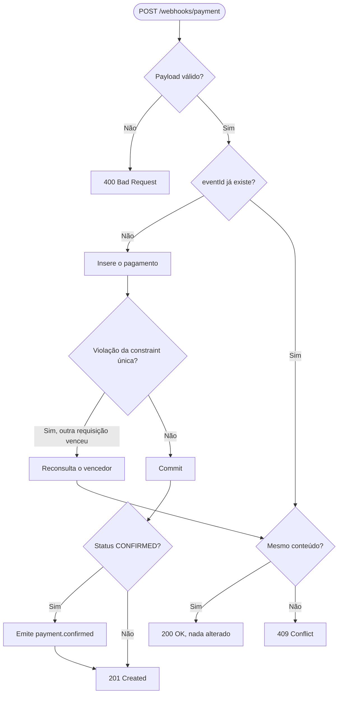

# payments-hub-nestjs

API REST que recebe eventos de pagamento de um gateway, grava no PostgreSQL sem duplicar pagamentos, permite consultar os pagamentos com filtro e paginação e avisa clientes conectados por WebSocket quando um pagamento é confirmado.

Projeto de portfólio, feito para demonstrar decisões de backend em um domínio sensível (pagamentos): idempotência, integridade no banco, validação de entrada, tratamento de erros e testes. Não integra com gateways reais.

## Problema que o projeto resolve

Gateways de pagamento reenviam eventos quando não recebem resposta a tempo. Sem tratamento, o mesmo pagamento pode ser registrado duas vezes, o que causa cobrança duplicada e saldo incorreto. Este projeto garante que **um `eventId` gera no máximo um pagamento**, mesmo com reenvios e requisições simultâneas, e diferencia um reenvio legítimo de um evento que chegou com o mesmo identificador e conteúdo diferente.

## Objetivos técnicos

- Idempotência no recebimento de webhooks, com garantia final no banco.
- Valores monetários sem ponto flutuante (`numeric(12,2)`).
- Validação de entrada na borda da API e formato de erro único.
- Persistência versionada com migrations.
- Notificação em tempo real somente após a gravação ser confirmada.
- Testes unitários dos fluxos de negócio, incluindo a corrida entre requisições.

## Tecnologias

| Tecnologia | Versão | Uso |
| --- | --- | --- |
| Node.js | 24 LTS | Runtime |
| TypeScript | 6 | Linguagem, modo estrito |
| NestJS | 12 | Framework (módulos, injeção de dependência, pipes, filtros) |
| MikroORM | 7 | ORM com Unit of Work e migrations |
| PostgreSQL | 16 | Banco de dados (Docker) |
| class-validator / class-transformer | 0.15 / 0.5 | Validação e conversão de DTOs |
| Socket.IO | 4 | WebSocket, via `@nestjs/platform-socket.io` |
| Swagger (`@nestjs/swagger`) | 12 | Documentação OpenAPI |
| Vitest | 4 | Testes unitários |
| oxlint | 1 | Lint |

## Arquitetura

A aplicação é dividida em módulos por domínio. Cada um tem uma responsabilidade clara:

| Módulo | Responsabilidade |
| --- | --- |
| `payments` | Consulta de pagamentos: listagem paginada e busca por id. Dono da entidade `Payment` |
| `webhooks` | Recebe eventos do gateway, aplica a regra de idempotência e decide o status HTTP |
| `websockets` | Gateway Socket.IO que emite `payment.confirmed` |
| `database` | Configuração do MikroORM e conexão com o PostgreSQL |
| `common` | Filtro global de erros e DTO de erro, usados por toda a API |

Responsabilidades dentro de cada módulo:

- **Controller**: recebe a requisição HTTP, delega ao service e define o status da resposta. Não contém regra de negócio.
- **Service**: contém a regra (idempotência, conflito, quando notificar). Não conhece HTTP.
- **DTO**: define o formato que entra e sai da API, com validação.
- **Entidade**: representa a tabela no banco.

Como os módulos se comunicam: o `WebhooksModule` importa o `WebsocketsModule` e recebe o `PaymentsGateway` por injeção de dependência. Não há dependência circular: o `WebsocketsModule` não conhece o webhook.

Fluxo de dados de uma requisição: o `ValidationPipe` valida o corpo antes do controller → o controller chama o service → o service grava via MikroORM → o controller converte a entidade em resposta pública com `toPaymentResponse` → o `AllExceptionsFilter` padroniza qualquer erro.

## Estrutura de diretórios

```
payments-hub-nestjs/
├── docker-compose.yml          # PostgreSQL 16 com healthcheck
├── .env.example                # Modelo de variáveis (o .env real não vai ao Git)
├── scripts/
│   └── payment-listener.mjs    # Cliente WebSocket de teste
├── src/
│   ├── main.ts                 # Bootstrap: pipes, filtro, Swagger, porta
│   ├── app.module.ts           # Módulo raiz
│   ├── common/
│   │   ├── dto/error-response.dto.ts
│   │   └── filters/all-exceptions.filter.ts   # Formato único de erro
│   ├── database/
│   │   ├── database.module.ts
│   │   ├── mikro-orm.config.ts
│   │   └── migrations/         # Migrations versionadas
│   ├── payments/
│   │   ├── entities/payment.entity.ts
│   │   ├── dto/                # Query de listagem, respostas
│   │   ├── payments.controller.ts
│   │   ├── payments.service.ts
│   │   └── payments.module.ts
│   ├── webhooks/
│   │   ├── dto/payment-webhook.dto.ts
│   │   ├── webhooks.controller.ts
│   │   ├── webhooks.service.ts  # Regra de idempotência
│   │   └── webhooks.module.ts
│   └── websockets/
│       ├── payments/payments.gateway.ts
│       └── websockets.module.ts
└── (testes *.spec.ts ao lado de cada arquivo)
```

## Fluxo de processamento do webhook



## Modelo de dados

Tabela `payment` (criada pela migration `Migration20261012191357`):

| Coluna | Tipo PostgreSQL | Restrição | Observação |
| --- | --- | --- | --- |
| `id` | `serial` | PRIMARY KEY | Identificador interno |
| `event_id` | `varchar(255)` | NOT NULL, UNIQUE | Identificador do evento no gateway |
| `amount` | `numeric(12,2)` | NOT NULL | Valor monetário, sem ponto flutuante |
| `status` | `text` | NOT NULL, CHECK | `PENDING`, `CONFIRMED` ou `FAILED` |
| `created_at` | `timestamptz` | NOT NULL | Preenchido na criação |
| `updated_at` | `timestamptz` | NOT NULL | Atualizado a cada alteração |

A constraint `UNIQUE` em `event_id` é a garantia final contra duplicidade. A checagem no código cobre o caso comum, mas não basta sozinha quando duas requisições chegam ao mesmo tempo.

## Endpoints

Documentação interativa com todos os schemas: **http://localhost:3000/docs** (Swagger).

| Método | Rota | Descrição | Respostas |
| --- | --- | --- | --- |
| `POST` | `/webhooks/payment` | Recebe um evento do gateway (idempotente) | `201`, `200`, `400`, `409`, `500` |
| `GET` | `/payments` | Lista pagamentos, com filtro por `status` e paginação | `200`, `400`, `500` |
| `GET` | `/payments/:id` | Busca um pagamento pelo id | `200`, `400`, `404`, `500` |

### Parâmetros

`POST /webhooks/payment` (corpo JSON):

| Campo | Tipo | Regra |
| --- | --- | --- |
| `eventId` | string | Obrigatório, de 1 a 255 caracteres |
| `amount` | string | Obrigatório, número maior que zero com até 2 casas decimais. Ex.: `"150.00"`. Número JSON é recusado |
| `status` | string | Obrigatório: `PENDING`, `CONFIRMED` ou `FAILED` |

Campos fora desses três são recusados com `400`.

`GET /payments` (query string):

| Parâmetro | Regra | Padrão |
| --- | --- | --- |
| `status` | Opcional: `PENDING`, `CONFIRMED` ou `FAILED` | Sem filtro |
| `page` | Inteiro maior ou igual a 1 | `1` |
| `limit` | Inteiro entre 1 e 100 | `20` |

## Exemplos

### Criar um pagamento (201)

```bash
curl -i -X POST http://localhost:3000/webhooks/payment \
  -H 'Content-Type: application/json' \
  -d '{"eventId":"evt_123456","amount":"150.00","status":"CONFIRMED"}'
```

```json
{ "id": 1, "eventId": "evt_123456", "amount": "150.00", "status": "CONFIRMED" }
```

### Repetição do mesmo evento (200)

Mesmo corpo do exemplo acima. A resposta traz o pagamento já existente e nada é alterado.

### Conflito: mesmo `eventId`, conteúdo diferente (409)

```bash
curl -i -X POST http://localhost:3000/webhooks/payment \
  -H 'Content-Type: application/json' \
  -d '{"eventId":"evt_123456","amount":"99.00","status":"CONFIRMED"}'
```

```json
{
  "statusCode": 409,
  "error": "Conflict",
  "message": "Já existe um evento com este eventId e conteúdo diferente",
  "path": "/webhooks/payment",
  "timestamp": "2026-10-12T19:34:24.000Z"
}
```

### Payload inválido (400)

```json
{
  "statusCode": 400,
  "error": "Bad Request",
  "message": [
    "eventId should not be empty",
    "amount deve ser uma string numérica maior que zero, com até 2 casas decimais",
    "status must be one of the following values: PENDING, CONFIRMED, FAILED"
  ],
  "path": "/webhooks/payment",
  "timestamp": "2026-10-12T19:52:20.637Z"
}
```

### Listar pagamentos confirmados (200)

```bash
curl -s "http://localhost:3000/payments?status=CONFIRMED&page=1&limit=2"
```

```json
{
  "data": [
    { "id": 10, "eventId": "evt_5", "amount": "50.00", "status": "CONFIRMED" },
    { "id": 9, "eventId": "evt_4", "amount": "40.00", "status": "CONFIRMED" }
  ],
  "meta": { "page": 1, "limit": 2, "total": 4, "totalPages": 2 }
}
```

### Buscar por id (404)

```bash
curl -i http://localhost:3000/payments/999999
```

```json
{
  "statusCode": 404,
  "error": "Not Found",
  "message": "Pagamento 999999 não encontrado",
  "path": "/payments/999999",
  "timestamp": "2026-10-12T19:52:20.728Z"
}
```

### Erros de paginação (400)

`GET /payments?limit=101` retorna `"message": ["limit must not be greater than 100"]`.

### Formato de erro

Todos os erros usam o mesmo formato: `statusCode`, `error`, `message` (texto ou lista), `path` e `timestamp`. Erros inesperados retornam `500` com a mensagem genérica `Erro interno do servidor`. O detalhe fica só no log.

## Evento WebSocket

- **Endereço**: `ws://localhost:3000/payments` (namespace `/payments`)
- **Evento**: `payment.confirmed`
- **Quando é emitido**: após a gravação de um pagamento **novo** com status `CONFIRMED`. Nunca para repetições, conflitos ou pagamentos `PENDING` e `FAILED`.
- **Payload**: `{ "id": 11, "eventId": "evt_ws_1", "amount": "100.00", "status": "CONFIRMED" }`

Para testar, com a API no ar: `npm run ws:listen` em um terminal e um webhook `CONFIRMED` em outro.

## Como executar

Pré-requisitos: Node.js 24 e Docker com Docker Compose v2.

A aplicação roda na sua máquina e o PostgreSQL roda no Docker. Assim o hot reload e o debugger funcionam sem configuração extra.

```bash
git clone <url-do-repositorio> payments-hub-nestjs
cd payments-hub-nestjs
cp .env.example .env          # troque POSTGRES_PASSWORD por um valor seu
npm install
docker compose up -d postgres # aguarde o status "healthy"
npm run migration:up          # cria a tabela payment
npm run start:dev
```

Endereços locais: API em `http://localhost:3000`, Swagger em `http://localhost:3000/docs`.

### Variáveis de ambiente

| Variável | Descrição | Padrão |
| --- | --- | --- |
| `POSTGRES_USER` | Usuário do PostgreSQL | obrigatória |
| `POSTGRES_PASSWORD` | Senha do PostgreSQL | obrigatória |
| `POSTGRES_DB` | Nome do banco | obrigatória |
| `POSTGRES_PORT` | Porta do PostgreSQL no host | `5432` |
| `POSTGRES_HOST` | Host do PostgreSQL usado pela aplicação | `localhost` |
| `PORT` | Porta da aplicação | `3000` |

A senha só vale na primeira criação do volume. Para trocá-la depois, rode `docker compose down -v` (apaga os dados) e suba de novo.

### Healthcheck do PostgreSQL

O container executa `pg_isready` a cada 5 segundos. O status `healthy` indica que o servidor aceita conexões, e não apenas que o processo existe. Isso evita tentar conectar antes de o banco estar pronto.

### Migrations

O schema é versionado em `src/database/migrations/`. Não use `schema:update`.

| Comando | Função |
| --- | --- |
| `npm run migration:up` | Aplica as migrations pendentes |
| `npm run migration:down` | Desfaz a última migration |
| `npm run migration:create -- --name <nome>` | Gera uma migration a partir da diferença entre entidades e banco |

### Scripts

| Comando | Função |
| --- | --- |
| `npm run start:dev` | Sobe a aplicação em modo watch |
| `npm run build` | Compila para `dist/` |
| `npm test` | Roda os testes unitários |
| `npm run lint` | Roda o oxlint |
| `npm run ws:listen` | Cliente de teste que escuta `payment.confirmed` |

Para parar o banco: `docker compose stop` mantém os dados. `docker compose down` remove containers e rede, mas mantém o volume.

## Como executar os testes

```bash
npm test
```

Os testes são unitários e não precisam de banco nem de servidor rodando. Cobrem:

- **Webhook (service)**: evento novo, repetição, conflito por valor e por status, falha de persistência, corrida entre requisições e a regra de notificação.
- **DTO do webhook**: payloads válidos e inválidos, normalização de `amount`, campos extras.
- **Filtro de erro**: formato padrão, lista de mensagens, 404, e 500 sem vazar detalhes internos.
- **Gateway WebSocket**: formato do payload e tolerância a falha na emissão.
- **Controllers e services de payments**: os specs de controller e de service de `payments` apenas confirmam que as classes são criadas. A lógica de paginação e de 404 ainda não tem testes unitários próprios.

Os testes não substituem a validação com o banco real. A constraint única foi verificada manualmente com inserções duplicadas no PostgreSQL.

## Decisões técnicas

- **Aplicação fora do Docker, banco dentro.** Mantém o hot reload e o debugger simples. Subir a aplicação em container também é válido, mas exige configuração de rede e volumes sem ganho nesta fase.
- **MikroORM em vez de TypeORM ou Prisma.** Exigência do projeto. Unit of Work, migrations versionadas e entidades com tipos claros.
- **`numeric(12,2)` para valores.** Ponto flutuante binário não representa decimais como `0.1` exatamente, o que gera diferenças de centavos. O valor trafega como string no JSON e no TypeScript, e o banco o devolve sem perda.
- **`amount` como string na entrada.** Um número JSON já chega como ponto flutuante. Recusar número e exigir string preserva a precisão.
- **Status com `CHECK` no banco.** O banco recusa estados inválidos mesmo se alguém inserir direto, sem passar pela aplicação.
- **Formato de erro único com filtro global.** Um ponto só define a forma das respostas de erro, e erros internos nunca vazam detalhes.
- **Validação com `whitelist`, `forbidNonWhitelisted` e `stopAtFirstError`.** Campos extras são rejeitados e cada campo mostra uma mensagem. O trade-off é que um campo com vários problemas mostra só o primeiro.
- **`id` inteiro sequencial.** Simples de depurar. A desvantagem é previsibilidade: quem consome a API pode inferir quantos pagamentos existem. Um UUID seria a alternativa.
- **Notificação direta após o commit.** Simples e suficiente para o escopo. A limitação está descrita abaixo.
- **Lista explícita de entidades no ORM.** O ORM conhece exatamente o que gerencia, sem varredura de pastas.

## Estratégia de idempotência

**Idempotência** significa que repetir a mesma operação produz o mesmo efeito que executá-la uma vez. Em pagamentos é essencial, porque gateways reenviam eventos após timeouts.

A implementação tem duas barreiras:

1. **Verificação na aplicação**: antes de gravar, busca o `eventId`. Cobre o caso comum e evita tentar uma escrita que sabidamente falharia.
2. **Constraint única no banco**: garante que, mesmo com duas requisições simultâneas que passem pela verificação, só uma grava. A segunda recebe `UniqueConstraintViolationException`, reconsulta o registro vencedor em um fork do EntityManager e aplica a mesma regra.

Depois de identificar o registro existente, a regra é:

| Situação | Resultado | Notifica? |
| --- | --- | --- |
| `eventId` novo | Grava, `201` | Só se `CONFIRMED` |
| Mesmo `eventId`, mesmo `amount` e `status` | Nada é alterado, `200` | Não |
| Mesmo `eventId`, `amount` ou `status` diferente | Não é tratado como processado, `409` | Não |

Erros de banco que não são de unicidade não são capturados: sobem como `500`, para não mascarar falhas reais.

## Limitações conhecidas

- **Sem verificação de assinatura do webhook.** Um gateway real assina cada requisição (HMAC) para que a aplicação confirme a origem. Aqui qualquer cliente pode enviar eventos. Esta é a maior lacuna para uso real.
- **Entrega do WebSocket não é garantida.** Se o processo cair depois do commit e antes do `emit`, o pagamento fica salvo e o cliente nunca recebe o evento. Não há registro persistente do que ainda precisava ser notificado.
- **Sem transições de status.** O sistema cria pagamentos, mas não há endpoint para mudar o status de um existente. Um evento de mudança de `PENDING` para `CONFIRMED`, por exemplo, hoje gera conflito.
- **WebSocket sem autenticação.** Qualquer cliente que conecte no namespace recebe os eventos. Dados sensíveis não deveriam sair por esse canal sem controle de acesso.
- **Escala limitada a uma instância.** O Socket.IO usa o adapter em memória. Com várias instâncias, cada uma notificaria só os próprios clientes.
- **Sem limite de taxa.** Não há proteção contra excesso de requisições.
- **Id previsível**, como descrito nas decisões.
- **Logs em texto simples**, sem correlação estruturada entre requisições.
- **Sem testes de integração automatizados.** A constraint única e o SQL gerado foram verificados manualmente, não por teste automatizado.

## Evoluções futuras

- **Padrão Outbox**: gravar o evento na mesma transação do pagamento, em uma tabela `outbox`, e um processo separado publicar e marcar como enviado. A entrega passa a ser "pelo menos uma vez", e o consumidor precisa tolerar duplicatas.
- **Assinatura HMAC do webhook** com timestamp, para validar origem e impedir reenvio antigo (replay).
- **Máquina de estados** para os status, com transições permitidas explícitas.
- **Adapter Redis para o Socket.IO**, para escalar com várias instâncias.
- **Autenticação no WebSocket** e controle de quais eventos cada cliente recebe.
- **Testes de integração** com um PostgreSQL efêmero (Testcontainers), cobrindo a constraint e a corrida de verdade.
- **Limite de taxa** no webhook e nas consultas.
- **Pipeline de CI** (lint, testes e build a cada push).
- **Imagem Docker da aplicação** para executar o stack completo com um comando.
- **Logs estruturados e métricas** com correlação por requisição.

## Licença

Sugestão: **MIT**. Antes de publicar, adicione um arquivo `LICENSE` com o texto da licença escolhida e o nome do autor.
